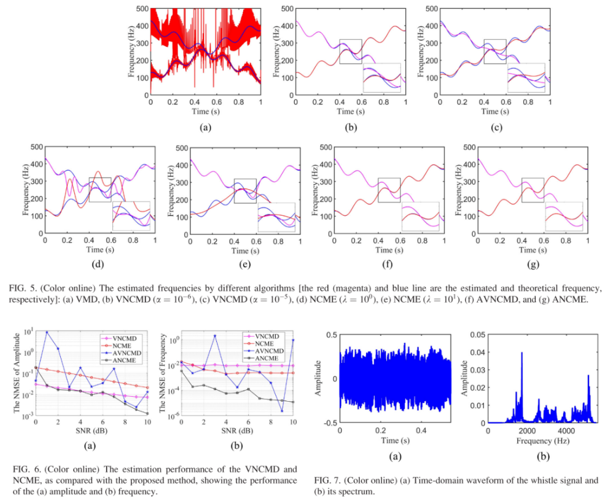
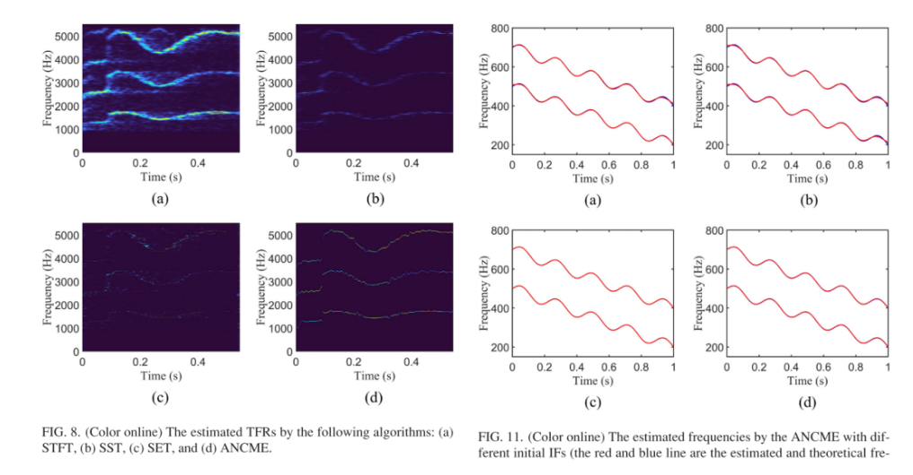
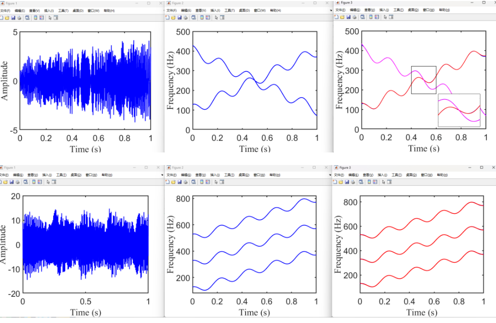

# [Signal Decomposition] Nonlinear Chirp Signal Adaptive Sparse Estimation Based on Laplace Prior [Attached MATLAB Code]

Abstract: The identification of nonlinear Chirp signals has been a hot topic in recent years, including variational mode decomposition and nonlinear Chirp mode estimation. However, most proposed methods cannot handle signals with closely spaced frequencies or rely on user-defined parameters that are often nontrivial for optimal selection. This paper proposes an adaptive nonlinear chirp mode estimation method. This approach decomposes the combined nonlinear chirped signal into multiple principal modes while accurately representing the time-frequency characteristics of each mode. Leveraging the sparsity of instantaneous amplitudes, this method can produce smooth estimates under segmented linearity. Furthermore, from a Bayesian perspective, the decomposition problem is analyzed, and a hierarchical Laplace prior is used to form an effective implementation that allows for automatic parameter selection. Numerical simulations and experimental data demonstrate the advantages and effectiveness of the obtained results. Notably, it is found that the algorithm can produce reliable estimates even when encountering signals with cross-modes. Finally, the practical value of this method is illustrated through the analysis of a whale whistle signal.
Introduction: Daily signals such as animal sounds, mechanical vibrations, and radar signals can be well modeled as nonlinear, strongly time-varying, and non-stationary signals. 1 -5 Typically, these signals consist of multiple components, each with instantaneous amplitude (IA) and instantaneous frequency (IF) that change over time, which can generally be well modeled as a sum of nonlinear chirp signals (NCS). Identifying and decomposing these signals, extracting their time-frequency features is a common problem in various fields, such as animal science, 6-8 fault diagnosis, 9, 10, and radar target detection.
Time-frequency analysis examines the joint distribution information of signals in both time and frequency domains, serving as a powerful tool for separating non-stationary signal patterns. Traditional time-frequency analysis methods such as Short-time Fourier Transform (STFT), Wavelet Transform, and S transform have been widely used for decades due to this reason. However, constrained by the Heisenberg Uncertainty Principle, these methods cannot simultaneously achieve high temporal and frequency resolutions, making it difficult to effectively analyze strong time-varying signals. Significant efforts have been made to improve the quality of time-frequency representations (TFR). For example, inspired by reassignment techniques, Daubechies et al. proposed Synchronous Compression Wavelet Transform (SST) 18, which improves TFR energy concentration by extracting time-frequency ridges and performing time-frequency energy rearrangement. Additionally, a series of higher-order variants based on SST have been proposed. 19 -22 However, SST and its variants also face challenges when analyzing strong time-varying signals. Moreover, these methods rely on further steps such as ridge detection to separate NCS.
An important aspect of non-stationary signal analysis is signal decomposition, which aims to break down complex signals into several modes and estimate their IA and IF. A representative time-domain decomposition method is Empirical Mode Decomposition (EMD), which can overcome the limitations of the Heisenberg Uncertainty Principle and form a high-resolution recursive decomposition of the signal. However, this algorithm is sensitive to noise and lacks a strict mathematical foundation. Gilles et al. proposed Empirical Wavelet Transform, adaptively designing suitable wavelet filters based on the processed signal. Later, Dragomiretskiy and Zoso studied Variational Mode Decomposition (VMD), which converts the mode decomposition problem into a variational problem. Combining with frequency domain information, VMD can successfully separate modes with different center frequencies. However, VMD is limited to processing local narrowband signals. Moreover, these methods cannot separate non-stationary components with close frequency intervals or overlapping frequency ranges, nor estimate IF.
Recently, Chen et al. proposed a variant of VMD called Variational Nonlinear Chirp Modulation Decomposition (VNCMD). This algorithm employs joint optimization techniques to address the demodulation problem and can simultaneously extract the overall signal pattern. Subsequently, Tu et al. introduced Nonlinear Linear Frequency Modulation Pattern Estimation (NCME), which utilizes the sparsity of the signal to progressively decompose the components. Additionally, Liang et al. proposed a method for Nonlinear Group Delay Pattern Estimation. By modeling the group delay as a function related to frequency, this approach can handle signals with transient pulses. Although these methods are generally effective, both rely on a series of user-defined parameters (e.g., penalty parameters, normalization parameters) that are often important for optimal selection but can significantly affect the accuracy of the decomposition results.
Simultaneously, numerous studies have shown that sparse reconstruction frameworks can efficiently identify signal parameters. In the work of Swaerd et al.,39 a sparse semiparametric algorithm was developed, treating networked control systems as piecewise linear over each short segment. Moreover, Meng et al. successfully extended this method to analyze signals with time-varying amplitudes.40 However, for efficiency, these methods typically require significant prior knowledge, such as decomposition basis functions or accurate frequency initialization. Furthermore, we investigated techniques that allow overlapping component separation, which are feasible for processing pulse-like signals.41 However, these models cannot adaptively decompose the multicomponent signals studied in this paper and do not allow automatic adjustment of weighting parameters. The Bayesian framework provides another powerful perspective for signal analysis. Analyzing signals from a Bayesian perspective can effectively infer the posterior probability distribution of signal parameters,42 automatically identify model parameters,43,44 enhance robustness against noise,45,46.
It is noteworthy that most existing methods cannot handle signals with close frequency intervals, and determining optimal user parameters is often not trivial. This paper proposes a data-driven adaptive method called Adaptive Nonlinear Linear Frequency Modulation Estimation (ANCME), which decomposes the NCS into its principal modes and accurately represents their TFR simultaneously. Specifically, we leverage the sparsity of signals, meaning that IA is smooth in the sense of being piecewise linear, forming an iterative data-driven process to separate each mode and corresponding frequencies. Here, estimated frequencies can be used to form a refined dictionary for use in the next iteration. Compared to our preliminary meeting paper, this paper further elevates the level of sparsity by using hierarchical Laplace priors to form effective implementations, thereby allowing fully automatic parameter estimation. Moreover, the proposed ANCME provides a robust estimation with small errors, while previous work was sensitive to noise. Numerical simulations and experimental data analysis demonstrate the effectiveness and superiority of the method. The experimental results show that the algorithm can accurately represent cross-modal signals. Finally, the effectiveness of the method is illustrated with a whale whistle signal example.
Full-text figure captions are provided below:
\n        \n  
\n        \n  
Conclusion This paper proposes an ANCME algorithm for multi-component NCS decomposition and TFR precise estimation. We utilize the sparsity of signals to form an iterative data-driven process to estimate each component and its corresponding frequency, which can then be used to update the reconstructed dictionary. Additionally, this paper introduces an adaptive efficient implementation method based on hierarchical Laplace priors, which has high sparsity and low reconstruction error. Using Bayesian formula, the parameters of the signal can be automatically estimated, enhancing the efficiency and robustness of the algorithm. Numerical simulations and experimental data prove the advantages and effectiveness of the obtained results.
Example program simulation results clear; close all\n​\nT = 15; % time duration\nSampFreq = 2000; % sample frequency\nt = 0:1/SampFreq:1; % time variables\n​\n% Instantaneous amplitudes (IAs) and instantaneous frequencies (IFs)\na4 = exp(-0.06*t)+t+0.5*sawtooth(25*pi*t,1); \nf4 = 100 + 300*t + 9*pi*cos(9*pi*t); \na5 = exp(-0.03*t)+t+0.5*sawtooth(20*pi*t,1); \nf5 = 400 - 300*t + 9*pi*cos(9*pi*t); \n​\n% A two-component simulated nonlinear chirp signal (NCS)\ny4 = a4.*cos(2*pi*(15+100*t+150*t.^2+sin(9*pi*t))); \ny5 = a5.*cos(2*pi*(20+400*t-150*t.^2+sin(9*pi*t))); \ng = y4 + y5; \n​\n% Show the signal's time-domain waveform and IFs\nfigure\nset(gcf,'Position',[20 100 640 500]); \nset(gcf,'Color','w'); \nplot(t,g,'b','linewidth',2); \nxlabel('Time (s)','FontSize',24,'FontName','Times New Roman'); \nylabel('Amplitude','FontSize',24,'FontName','Times New Roman'); \nset(gca,'xtick',[0 0.2 0.4 0.6 0.8 1]); \nset(gca,'FontSize',24); \nset(gca,'linewidth',2); \n​\nfigure\nset(gcf,'Position',[20 100 640 500]); \nset(gcf,'Color','w'); \nplot(t,[f4; f5],'b','linewidth',2); \nxlabel('Time (s)','FontSize',24,'FontName','Times New Roman'); \nylabel('Frequency (Hz)','FontSize',24,'FontName','Times New Roman'); \nset(gca,'xtick',[0 0.2 0.4 0.6 0.8 1]); \nset(gca,'FontSize',24); \nset(gca,'linewidth',2); \n​\n​\n%% ANCME\nbeta = 1e-8; % filter parameter\ntol = 1e-3; % tolerance of convergence criterion\niniIF = [100+300*t; 400-300*t]; % initial IFs\n​\n% Start ANCME algorithm\ntic\n[estIF, estIA, estMode] = ANCME(g, SampFreq, iniIF, beta, tol); \ntoc\n​\n​\n%% The SNRs and REs of the estimated modes and frequencies \nSNR1 =  20*log10(norm(y4)/norm(y4 - estMode(1,:,end)))\nSNR2 =  20*log10(norm(y5)/norm(y5 - estMode(2,:,end)))\n​\nRE1 =  norm(estIF(1,:,end)-f4)/norm(f4)\nRE2 =  norm(estIF(2,:,end)-f5)/norm(f5)\n​\n​\n%% Show the estimated IF\nfigure; x1 = 0.4; y4 = 180; x2 = 0.6; y5 = 320; \nplot(t,[f4; f5],'b','linewidth',1.5); \nhold on; \nplot(t,estIF(1,:,end),'r','linewidth',1.5); hold on; \nplot(t,estIF(2,:,end),'m','linewidth',1.5); \nset(gcf,'Position',[20 100 640 500]); \nset(gcf,'Color','w'); \nxlabel('Time (s)','FontName','Times New Roman'); \nylabel('Frequency (Hz)','FontName','Times New Roman'); \nset(gca,'xtick',[0 0.2 0.4 0.6 0.8 1]); \nylim([0 500])\nset(gca,'FontSize',24)\nset(gca,'linewidth',2); \nrectangle('Position',[x1 y4 x2-x1 y5-y4],'EdgeColor','k','Linewidth',1); \nh1 = axes('position',[0.62 0.20 0.25 0.25]); \naxis(h1); \nplot(t,[f4; f5],'b','linewidth',1.5); \nhold on; \nplot(t,estIF(1,:,end),'r','linewidth',1.5); hold on; \nplot(t,estIF(2,:,end),'m','linewidth',1.5); \nxlim([x1 x2]); ylim([y4 y5]); \nset(gca,'xticklabel',[]); set(gca,'yticklabel',[]); \nset(gca,'fontsize',12)\n​\n\n        \n

## Images

<!-- PAYMENT_BLOCK -->

## Get this dataset

- Payment link (Stripe): [Buy now](https://buy.stripe.com/3cs8yP7sY87d0vu9AB)
- Payment QR code: 

<!-- /PAYMENT_BLOCK -->
